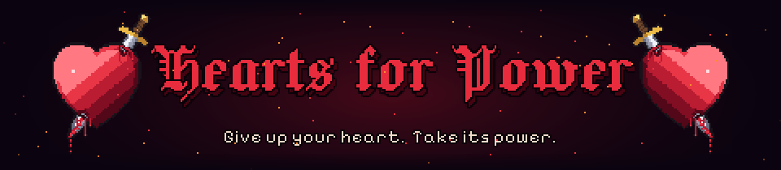

# Hearts for Power

**A pixel-art dungeon roguelite where every upgrade costs you a piece of your heart.**

Play it on itch.io: **https://d4nielwth.itch.io/hearts-for-power**



You start with three heart containers. Every spell, upgrade and ability is bought by sacrificing them for good: grow stronger, get more fragile, and see how deep you can go before your heart gives out.

## Features

- **Sacrifice for power:** upgrades cost half a heart container, spells a whole one. Treasure rooms get pricier with every purchase.
- **Endless, generated floors:** Isaac-style maps of rooms; doors slam shut and monsters claw their way out of the ground.
- **Three worlds:** the Mossy Dungeon, the Bone Crypt and the Lava Caves, each with its own monsters, traps and music.
- **Three bosses:** the King Slime, the Ancient Lich and the Orc Warlord. They return stronger, and enraged, on later loops.
- **Monsters:** slimes that split, skeleton archers, charging orcs, bats, ghosts that fade out, mimics hiding in pots, and necromancers whose spirits can't die until they do. Rare champions get a coloured aura and a special trait.
- **Abilities:** sword, Dash, Bombs, Magic Bolt, Fireball, Ice Shards and Lightning, all levelled up by buying them again.
- **Rooms that fight back:** rocks, pits, spike traps and breakable pots.

## Controls

| Key | Action |
|---|---|
| WASD | Move |
| Space | Swing your sword |
| Shift | Dash (once unlocked) |
| E | Drop a bomb (once unlocked) |
| Q / R / F / C | Magic Bolt / Fireball / Ice Shards / Lightning |
| Esc or P | Pause |

## Running the project

1. Open the folder in **Unity 6** (6000.6 or newer) through Unity Hub.
2. Open `Assets/Scenes/SampleScene.unity` and press Play.

Monster and boss prefabs are built automatically by `Assets/Editor/MonsterSetup.cs` if they're missing
(menu: **Hearts for Power > Build Missing Monster Prefabs**).

**Editor-only debug keys** (never active in a build):
- F5: kill everything (Shift+F5: spawn a necromancer)
- F6: +1 heart container
- F7: go to the boss room (Shift+F7: next floor)
- F8: invincibility
- F9: take half a heart
- F10: go to the treasure room

## Project layout

```
Assets/
  Scripts/       game code (Core, Rooms, Enemies, Player, Combat, UI)
  Editor/        prefab builder
  Animations/    generated sprite sheets, clips and animator controllers
  Resources/     sprites, prefabs, audio and fonts loaded at runtime
Visuals/         Python generators that produce all the art and audio
```

All pixel art, sound effects and music are **generated by code** in `Visuals/` (Python 3 with Pillow and NumPy):

| Generator | Produces |
|---|---|
| `knight_generator/` | the knight and his sword |
| `monster_generator/monsters.py`, `new_monsters.py` + `unity_export.py` | monster sprites and animations |
| `monster_generator/bosses.py` (with `orc_warlord.py`, `ancient_lich.py`) | boss sprites and animations |
| `room_generator/room_art.py` | tilesets and props for all three floor themes |
| `fx_generator/fx.py` | effects, projectiles, item icons |
| `ui_generator/ui_art.py` | title emblem and menu panels |
| `audio_generator/sfx.py`, `music.py` | sound effects and chiptune music |
| `cover/` | itch.io cover, banners and page background |

Re-run a generator (for example `python Visuals/audio_generator/sfx.py`) and Unity picks up the changes.

## Credits

- Game by **d4niel.wth**
- Fonts: [Jacquard 24](https://fonts.google.com/specimen/Jacquard+24) by The Soft Type Project and
  [Pixelify Sans](https://fonts.google.com/specimen/Pixelify+Sans) by Stefie Justprince, both under the
  SIL Open Font License (see `Assets/Resources/Fonts/`).

## License

Copyright © d4niel.wth. All rights reserved. The source is published to read and learn from, but the game,
its code and its assets may not be redistributed or reused without permission. The bundled fonts keep their
own Open Font License.
